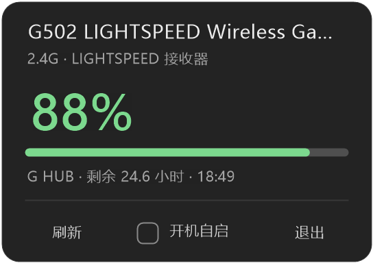
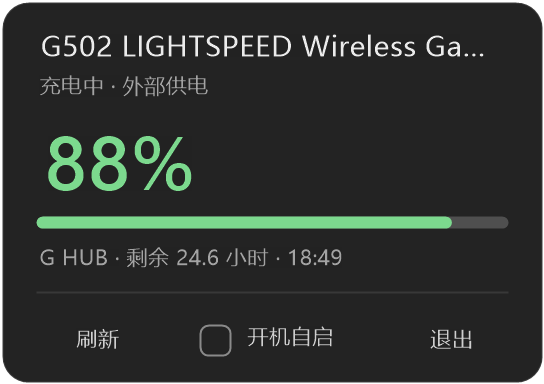

# BatteryPill · 电量胶囊

把无线鼠标的电量塞进 **Windows 11 任务栏右下角、时钟左边** 的一个小胶囊里。挂在任务栏的
子窗口里，不占托盘、不弹窗，鼠标一瞥就能看到。


## 特性

- **真实电量**：优先问 G HUB 的本地接口，拿到的是设备电量计读数，**插着线充电时也有百分比**
- **不依赖 G HUB**：G HUB 没开 / 没装时自动回落到罗技 HID++ 2.0，直接跟接收器通话
- **颜色分档**：≥60% 绿 · 30–59% 黄 · <30% 红
- **睡眠置灰**：鼠标休眠读不到时，保留上次读数并显示为灰色，而不是变成一个横杠
- **点击**：左键点胶囊弹出面板（设备名、大号电量、电量条、电压、更新时间、剩余时间，
  以及「刷新 / 开机自启 / 退出」）；右键留给任务栏自己的菜单
- **低开销**：纯 Win32 + WinForms（.NET Framework 4.8，系统自带），单文件 exe 约 50 KB，
  空闲 CPU 接近 0
- **单实例 + 开机自启**（面板里勾选，写 `HKCU\...\Run`）

## 界面

胶囊有四种状态：

| 正常 | 充电中 | 睡眠（灰色） | 低电量 |
|---|---|---|---|
|  |  |  |  |

点开是面板：

| 无线 | 充电中 |
|---|---|
|  |  |

鼠标图标和闪电都是 GDI+ 现画的矢量图形，项目里没有位图资源；上面这些图由
`BatteryPill.exe --shot <目录> [缩放]` 离屏渲染生成——不截屏、不依赖任务栏，换台机器也能复现。

## 装在哪、怎么开

直接跑 `BatteryPill.exe` 即可，没有安装器。建议放在一个**普通用户目录**（比如
`%LOCALAPPDATA%\BatteryPill\`），不要用管理员权限运行——

> Win11 的任务栏属于 Explorer（Medium 完整性）。本程序用 `SetParent` 把胶囊挂进任务栏，
> 如果进程是 **Low 完整性**（从带低完整性标签的目录启动）或 **High 完整性**（管理员），
> 挂接会被拒绝（错误 5），胶囊只能浮在任务栏上沿。第一次运行若弹 **“Windows 已保护你的电脑”**，
> 点「更多信息 → 仍要运行」即可（未签名程序）。

## 配置

首次运行在 exe 同目录生成 `settings.ini`，改完重启程序生效：

```ini
# 刷新间隔（秒）
refresh = 60
# 胶囊右边缘离任务栏右边缘的距离（DIP）
# 默认 118 = 让开 Win11 的时钟区
offset_right = 118
pill_width = 100
pill_height = 32
# secondary = 副屏任务栏；primary = 主屏
monitor = secondary
# 电压采样间隔（分钟，0 = 关闭），用来积累真实放电曲线、校准 voltage_full/empty
sample_minutes = 60
voltage_full = 4200
voltage_empty = 3500
```

## 数据来源

1. **G HUB 本地 WebSocket**（`src/Ghub.cs`）—— 优先。
   `lghub_agent.exe` 在 `ws://127.0.0.1:9010` 上开了一个接口：握手带 `Origin: file://` 和
   `Sec-WebSocket-Protocol: json`，然后 `GET /devices/list`、`GET /battery/<deviceId>/state`，
   回来的 `percentage` / `mileage` / `charging` 就是 G HUB 界面上那个数。
   **插线充电时也有真实百分比**，因为它是设备电量计的读数，而不是拿电压推的。
   协议出自 [LGSTrayBattery_GHUB](https://github.com/andyvorld/LGSTrayBattery_GHUB) 的逆向结果。
2. **HID++ 2.0**（`src/Logitech.cs`）—— 回落。
   枚举 usage page `0xFF00`、输入输出各 20 字节的控制通道，对设备索引 1..6 / `0xFF` 逐个
   `getFeature(0x1001)`，读电压（毫伏，大端）+ 状态位：
   `bit7` = 外部供电，`bit0–2` = 充电状态（0 充电中 / 1 充满 / 2 停充 / 7 硬件错误）。
   电压按锂电曲线插值成百分比；**充电时电压被钳在 4.2 V 附近，跟电量无关，所以只显示「⚡ 充电中」**，
   数字用充电前最后一次无线读数。

两者都拿不到时，胶囊保留上次读数并显示为灰色（面板里写「设备无响应 · 显示上次读数」）。

> G HUB 在无线模式下偶尔会把「读不到电量计」显示成 0%。胶囊对这种情况做了交叉验证：
> G HUB 报 ≤1% 且不在充电时，会补读一次 HID++ 电压，电压换算 ≥10% 就以 HID++ 为准，
> 不会跟着 G HUB 显示一个假的 0%。

## 点击为什么用 Raw Input

Win11 的任务栏（XAML InputSite）会**抓住整个任务栏区域的鼠标捕获**，任务栏里其它进程的子窗口
收不到 `WM_LBUTTONUP`。表现就是：点任务栏任意位置之后，再点胶囊毫无反应。
所以点击和悬停改由 **Raw Input（`RIDEV_INPUTSINK`）旁路监听**：只“看”不拦截，坐标落在胶囊里
就开关面板，落在面板按钮上就执行，落在外面就收起面板。面板也改成 `WS_EX_NOACTIVATE`。

## 电压采样日志

`battery-log.csv`（exe 同目录），每 `sample_minutes` 分钟一条：

```csv
time,voltage_mv,percent,ext_power,flags
2026-11-02 22:43:48,4175,98,0,0
```

`ext_power=1` 表示当时插着线（充电电压虚高，拟合时剔除）。攒够一段无线放电样本后，可以用真实
数据把 `voltage_full` / `voltage_empty` 定死。`diag.log` 是诊断日志，超过 256 KB 自动轮转。

## 源码结构

| 文件 | 作用 |
|---|---|
| `src/Program.cs` | 入口、单实例、1 秒定时器、读电量线程、面板开关 |
| `src/PillWindow.cs` | 胶囊本体：挂在任务栏下的分层子窗口，负责绘制/点击/位置 |
| `src/PanelForm.cs` | 点开的详情面板（也是分层窗口） |
| `src/Layered.cs` | `UpdateLayeredWindow` 逐像素透明窗口的基类 |
| `src/Ghub.cs` | G HUB 本地 WebSocket 客户端 |
| `src/Logitech.cs` | HID++ 2.0 电量读取 + 电压→百分比曲线 |
| `src/Hid.cs` | HID 枚举 + 重叠 I/O 的读写封装 |
| `src/RawMouseWatcher.cs` | Raw Input 旁路监听鼠标点击 |
| `src/Settings.cs` | ini 读写、开机自启 |
| `src/Native.cs` | P/Invoke 声明 |

## 重新编译

```bat
build.cmd
```

需要 .NET Framework 4.8（Win10/11 自带）和 Roslyn 编译器（`dotnet` SDK 里的 `csc.dll`，
路径写在 `build.cmd` 里）。编译完会自动复制到 `%LOCALAPPDATA%\BatteryPill\`。

## 已知限制

- 只支持**罗技**设备（G HUB 通道 + HID++ 2.0）；别的牌子的私有协议还没接
- 键盘的电量还没接（同一接收器上的第二个设备索引，之后可以加）
- G HUB 完全退出时，充电中只有「充电中」，没有百分比（HID++ 的原理限制）
- 只做了 Windows 11 的任务栏；Windows 10 的任务栏结构不同，没测过

## 致谢

- [LGSTrayBattery_GHUB](https://github.com/andyvorld/LGSTrayBattery_GHUB)：G HUB 本地 WebSocket 协议
- [Solaar](https://github.com/pwr-Solaar/Solaar)：HID++ 2.0 特性与电池状态位定义
